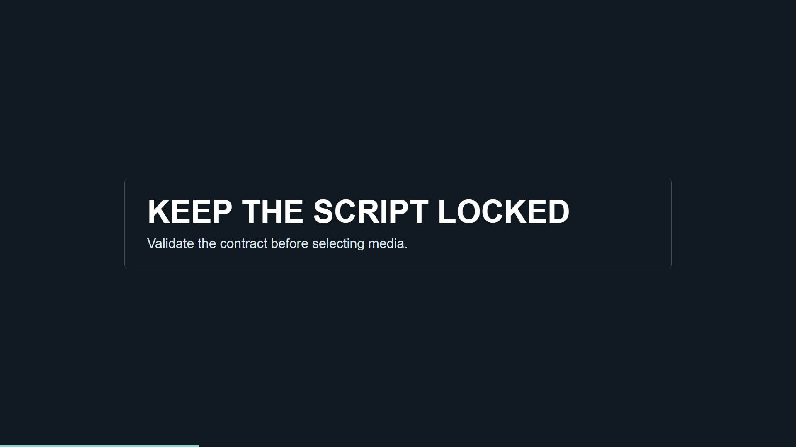

# Longform Video Engine

Turn a locked, approved script into a narrated horizontal video through staged voice, asset, rendering, and quality checks.

The engine handles post-script production. Its input contract fixes the narration and script hash; stage orchestration coordinates voice alignment, visual planning, media selection, Remotion rendering, and QA.

[Guía operativa completa en español](README.es.md)

## Demonstration



See the [reproducible walkthrough and its validation scope](docs/DEMO.md).

## Project direction and use

[Kenneth Yepez](https://github.com/kennethyepez) directs product requirements, architecture, integration, validation, and deployment. AI coding agents implement code under his direction.

See [use and licensing](LICENSE.md), [contributing](CONTRIBUTING.md), and [security reporting](SECURITY.md).

## Architecture

```text
ApprovedScript contract
  -> validate script lock and hash
  -> voice and alignment
  -> visual plan and asset routing
  -> Remotion props
  -> draft render and QA
  -> gated master output
```

| Component | Responsibility |
| --- | --- |
| [Input schema](contracts/approved_script.schema.json) | Locked script, chapters, audience, duration, and optional media/design context |
| [Contract validation](engine/longform_contract.py) | Input validation and script integrity |
| [Stage orchestrator](engine/longform_pipeline.py) | Validation, voice, planning, assets, props, render, QA, and run status |
| [Provider adapters](providers/) | Voice and media integrations |
| [Remotion project](remotion/) | Frame-based video composition |
| [Longform tests](tests/test_longform.py) | Contract and pipeline regression cases |

The repository evolved from a vertical-video engine and retains that implementation. The longform entry point is `engine.longform_pipeline`; the older `engine.pipeline` is a separate workflow.

## Start with contract validation

From an isolated clone, install the Python requirements. Rendering also needs the Node dependencies under `remotion/` and the external tools described in the operating guide.

```bash
python -m pip install -r requirements.txt
python -m engine.longform_pipeline --help
```

Build a contract from your own approved script:

```bash
python tools/build_approved_script.py approved_script.md contracts/my_video.json --run-id video-001 --title "Approved video title" --thumbnail-promise "Approved promise" --target-minutes 3 --audience-profile "Viewers learning a specific, documented practical skill"
python -m engine.longform_pipeline validate contracts/my_video.json
```

Contract creation and validation establish input structure and integrity. They do not demonstrate completed media production.

## Offline development and real production

Select mock provider configuration in PowerShell with:

```powershell
$env:PROVIDER_MODE = 'mock'
```

Individual production stages reuse artifacts from earlier stages. For example, `props` requires existing voice-alignment and resolved-plan files; it is not a shortcut from a new contract. Mock artifacts exercise pipeline behavior and are not evidence of provider output quality.

For real production, configure your own credentials using [.env.example](.env.example), install the Remotion dependencies, and follow [media routing](docs/MEDIA_ROUTING_LONGFORM.md) and [music/preflight setup](docs/PRODUCCION_SUNO_Y_PREFLIGHT.md). A full run can invoke paid providers and requires the configured local services.

```bash
npm ci --prefix remotion
python -m engine.longform_pipeline full contracts/my_video.json
```

The documented flow requires a provenance manifest for music obtained through an authenticated Suno browser session. The repository does not provide an official Suno API. Review the complete prerequisites before requesting a full run.

## Artifacts and design choices

- `work/longform_runs/<run_id>/`: contracts, plans, manifests, and QA.
- `remotion/public/runs/<run_id>/`: audio and assets used by the renderer.
- `out/longform/<run_id>/master.mp4`: final output when the gates pass.

Script hashes help prevent stages from silently changing approved narration. Media routing distinguishes literal evidence from illustrative material. Draft review precedes master output, while run metadata records provenance and stage state.

## Verification and limits

```bash
python -m unittest discover -s tests -v
npm run typecheck --prefix remotion
```

Tests cover contracts and orchestration; some checks require configured runtime dependencies. They do not by themselves establish audiovisual quality, cost, throughput, or production readiness.

A benchmark run with an approved input, actual provider usage, elapsed time, cost, and reviewed video remains needed for those claims. Consult the [Spanish operating guide](README.es.md) for detailed routing rules, legacy vertical commands, and production procedures.

See [pipeline boundaries](docs/ARCHITECTURE.md) and the [optional asset library](asset-library/README.md). Historical source snapshot records are in `docs/history/`.

## Reviewed delivery

See the [delivery workflow](docs/DELIVERY.md) for acceptance criteria, commit boundaries, identified AI/human review, protected integration, and source provenance.
