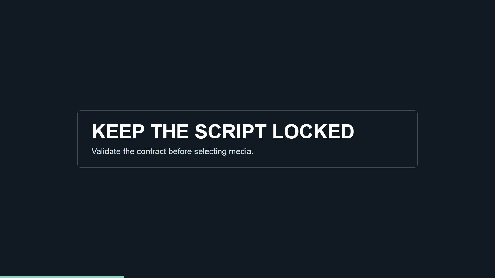

# Locked-script and renderer workflow



## Reproduce

Python 3.13, Node 24, FFmpeg; first Remotion render may download its official headless browser. The optional asset library is not needed; its original bytes remain on the preservation branch.

Use an isolated checkout and environment.

```bash
python -m pip install -r requirements.txt
python -m engine.longform_pipeline --help
python -m unittest discover -s tests -v
npm ci --prefix remotion
npm run typecheck --prefix remotion
python tools/create_demo.py --render
```

Serve the generated files locally:

```bash
python -m http.server 8000 --bind 127.0.0.1 --directory docs/examples
```

Open `http://127.0.0.1:8000/walkthrough.html`.

## What the example establishes

The authored two-chapter script passes the actual approved-script contract validator. An original still frame is rendered from the Longform Remotion composition with text only. This validates the contract and renderer entry point, not a completed video: no narration, selected footage, live provider call, editorial approval, or production QA is claimed. No supplied image is transformed.

The screenshot records the visible output of this workflow. It does not establish behavior outside the stated scope. Generated evidence and source examples are preserved alongside the walkthrough; current CI runs provide commit-specific checks.
